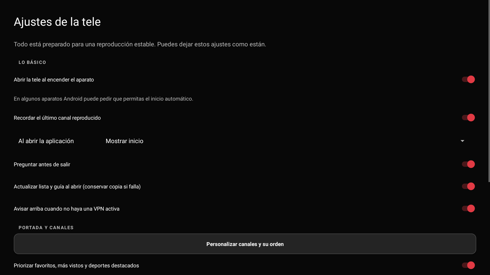

# OpenStream TV

Reproductor IPTV de código abierto para Android TV y Amazon Fire TV. Rápido de usar con mando, pensado para directos estables y creado desde cero.

[](https://github.com/rafaelgarciavalcarcelamo/OpenStreamTV/releases/latest)
[](https://github.com/rafaelgarciavalcarcelamo/OpenStreamTV/releases/latest)
[](LICENSE)

> No incluye canales, listas, cuentas ni contenido. Usa únicamente fuentes M3U/XMLTV que tengas derecho a reproducir.

**[Descargar la última versión](https://github.com/rafaelgarciavalcarcelamo/OpenStreamTV/releases/latest)** · [Instalación](#instalación-en-android-tv-y-fire-tv) · [Privacidad](PRIVACY.md) · [Seguridad](SECURITY.md) · [English](docs/en/README.md)

## Instalación en Android TV y Fire TV

1. Abre la página de [Releases](https://github.com/rafaelgarciavalcarcelamo/OpenStreamTV/releases/latest) desde el televisor o descarga el APK en otro dispositivo y pásalo por USB.
2. Descarga el archivo `OpenStreamTV-0.13.1.apk` de la versión más reciente.
3. Si Android lo solicita, permite la instalación desde la aplicación con la que abriste el APK (navegador o gestor de archivos).
4. Instala, abre OpenStream TV y elige **Añadir lista**.
5. Añade una lista M3U, una cuenta Xtream autorizada y, opcionalmente, una guía XMLTV.

Las actualizaciones se avisan automáticamente una vez al día. También puedes buscarlas manualmente desde **Ajustes → Buscar actualización ahora**.

> Si instalaste una APK debug de pruebas anterior a `0.13.0`, desinstálala antes de instalar una release firmada. La desinstalación borra los datos guardados en la aplicación.

## Capturas

La pantalla de ajustes está diseñada para que una persona sin experiencia técnica pueda mantener una reproducción estable sin tocar opciones avanzadas.



Las capturas se actualizan con cada versión visual importante.

## Funciones incluidas

- Portada de estilo cinematográfico para televisor: canal destacado, filas horizontales de canales y categorías, logos y foco claro al usar el mando.
- Orden inteligente de Inicio: canales fijados, favoritos y más vistos según el uso local del usuario.
- Pantalla de personalización para añadir, quitar, subir y bajar canales; el orden elegido también se aplica al catálogo y al cambio de canal.
- Acceso superior a Inicio, Canales, Favoritos, Buscar, Mis listas y Ajustes; «Reproducir» abre el último canal visto.
- Aviso superior discreto cuando Android no detecta una VPN activa; abre los ajustes de VPN y puede desactivarse desde Ajustes.
- Catálogo de dos paneles optimizado para mando: categorías y canales con el programa actual cuando hay guía.
- Categorías y canales en dos paneles con foco visible, número de canal, programa actual y una pantalla vacía con instrucciones sencillas.
- Guía rápida sobre la imagen con OK o MENÚ, cambio de canal con arriba/abajo y selección por número cuando el mando tiene teclado numérico.
- Importación M3U/M3U8 por URL o selector de archivo.
- Acceso Xtream Codes mediante servidor, usuario y contraseña; importa categorías y canales en directo.
- Credenciales y catálogo Xtream cifrados con una clave no exportable de Android Keystore.
- Guía XMLTV por URL, también si llega comprimida con gzip.
- Búsqueda, grupos y favoritos persistentes (pulsación larga sobre un canal).
- Historial local de canales reproducidos, reiniciable desde Ajustes y usado para ordenar la portada sin enviar datos fuera del dispositivo.
- Reproducción en directo con AndroidX Media3/ExoPlayer, HLS y flujos progresivos compatibles.
- Cambio rápido de canal con arriba/abajo o Channel Up/Down.
- Perfiles de búfer Rápido, Equilibrado, Estable y Personalizado.
- Ajustes independientes de búfer mínimo, máximo, arranque y reanudación.
- Perfil predeterminado para instalaciones nuevas: 60–180 s de búfer, 10 s antes de iniciar, 15 s para reanudar y 30 s de retraso del directo.
- Resolución máxima, modo de imagen, idiomas preferidos y fallback de decodificador.
- Preferencia independiente de decodificador de vídeo y audio: automático, hardware o software.
- Perfil estable con 15 segundos de retraso objetivo en HLS, margen de directo adaptativo y recuperación al borde de la emisión.
- Reintentos HTTP con espera progresiva y reconexión continua mientras la pantalla de reproducción esté abierta.
- Detector de reproducción congelada y de búfer prolongado.
- Reconexión automática cuando vuelve la red.
- OkHttp con reutilización de conexiones y sin dependencia de Google Play Services, adecuado para Fire TV.
- Actualización transaccional de listas y EPG: una descarga incorrecta no sustituye la última copia válida.
- Cola asíncrona opcional del códec para dispositivos Android/Fire OS antiguos.
- Perfil de compatibilidad persistente por canal: recuerda límites de calidad y fallback de software.
- Recuperación de fallos de decodificación de vídeo y audio por separado.
- Espera máxima de 60 segundos entre intentos ordinarios, y de cinco minutos cuando el servidor rechaza las credenciales.
- Calidad adaptativa: reduce 2160p → 1080p → 720p → 480p → 360p tras rebuffers repetidos.
- Panel técnico durante la reproducción con el botón INFO o MENÚ del mando.
- El panel muestra códecs, decodificadores, resolución, FPS, red, búfer, retraso, frames perdidos y último error.
- Liberación de la guía EPG cuando Fire TV solicita memoria y restauración asíncrona al volver.
- Inicio automático opcional al recibir `BOOT_COMPLETED` en Fire TV/Android TV compatibles.
- Inicio configurable en la portada, favoritos o último canal reproducido.
- Actualización silenciosa de lista y EPG al abrir, conservando siempre la copia funcional.
- Confirmación de salida y memoria del último canal.
- Comprobación diaria opcional de nuevas versiones publicadas en GitHub, aviso en pantalla y acceso directo a la descarga del APK.
- Botón manual «Buscar actualización ahora» en Ajustes.
- Perfil recomendado predeterminado: búfer Personalizado de 60–180 s, 10 s antes de iniciar, 15 s tras un corte, 30 s de retraso, 1080p, reconexión continua y fallback activo.
- Reconexión automática configurable, timeouts de red, retraso del directo, User-Agent y reproducción automática.
- Funciona sin registro: la configuración permanece en el dispositivo.
- La guía se carga fuera del hilo de la pantalla; las descargas tienen límites de tamaño para evitar agotar el almacenamiento.

La reconexión automática actúa mientras la pantalla de reproducción esté abierta. Si el servidor deja de emitir, la cuenta caduca o la conexión carece de capacidad suficiente, puede haber pausas pese a los reintentos. El retraso de 30 s se aplica a directos HLS que anuncian una ventana temporal; en flujos TS continuos la reserva depende del búfer acumulado.

## Compilar

Requisitos: Android Studio/JDK 17 y Android SDK 36.

```powershell
./gradlew.bat testDebugUnitTest assembleDebug
```

El APK queda en `app/build/outputs/apk/debug/app-debug.apk`.

### Distribución de producción

Las APK que se publiquen deben compilarse con una clave de firma de producción estable; no distribuyas APK debug. La compilación usa estas variables de entorno, que no se guardan en Git:

```text
OPENSTREAM_RELEASE_STORE_FILE
OPENSTREAM_RELEASE_STORE_PASSWORD
OPENSTREAM_RELEASE_KEY_ALIAS
OPENSTREAM_RELEASE_KEY_PASSWORD
```

Con la clave configurada, genera y verifica la distribución con:

```powershell
./gradlew.bat clean assembleRelease
apksigner verify --verbose app/build/outputs/apk/release/app-release.apk
```

El comprobador de actualizaciones consulta el manifiesto y las APK públicas de este mismo repositorio. Solo se deben publicar APK firmados con la misma clave de producción.

Las comprobaciones de Android se ejecutan también en GitHub Actions. Las áreas de estabilidad pendientes y las siguientes funciones están documentadas en [docs/ESTABILIDAD.md](docs/ESTABILIDAD.md).

## Alcance del MVP

Esta versión importa televisión en directo mediante Xtream Codes. No implementa todavía películas/series Xtream, grabación, catch-up, sincronización entre dispositivos, PiP ni control parental.

## Licencia

Código disponible bajo licencia MIT. Consulta `LICENSE`.

Consulta también la [política de privacidad](PRIVACY.md) y las indicaciones de [seguridad](SECURITY.md).
